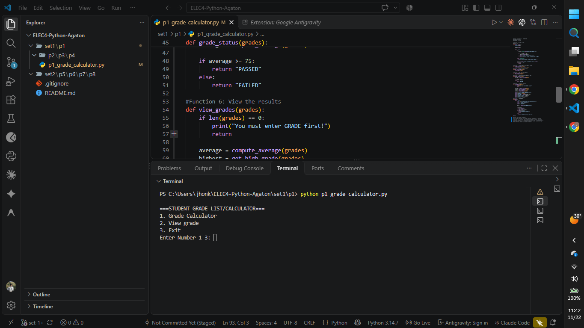

# ELEC 4 – Python Activities

**Name:** Jhon Kurt V. Agaton  
**Section:** IV-BSIT 
**Course:** ELEC 4 – Elective 4 (Python Programming)

---

## Set 1 Activities

### P1 – Grade Calculator
A Python program that allows users to enter grades and view grade information through a menu.

**Folder:** [P1 – Grade Calculator](set1/p1/)

**How to run:**
```bash
python set1/p1/p1_grade_calculator.py
```

**Screenshot:**



---

### P2 – Custom Module: student_utils
A Python program used import module, just like calling the backend from frontend,
the frontend is the p2main.py and the backend is the student_utils.py

**Folder:** [P2 – student_utils,p2_main.py](set1/p2/)

**How to run:**
```bash
python set1/p2/p2_main.py
```

**Screenshot:**


---

### P3 – Student Record Manager
This program allow the user to add, remove, search, display the students name

**Folder:** [P3 – Student Record Manager](set1/p3/)

**How to run:**
```bash
python set1/p3/p3_record_manager.py
```

**Screenshot:**


---

### P4 – Safe Menu Program
This code allows the user to make a math division, and can asks for a file name and displays its contents

**Folder:** [P4 – Safe Menu Program](set1/p4/)

**How to run:**
```bash
python set1/p4/p4_exceptions.py
```

**Screenshot:**


---
